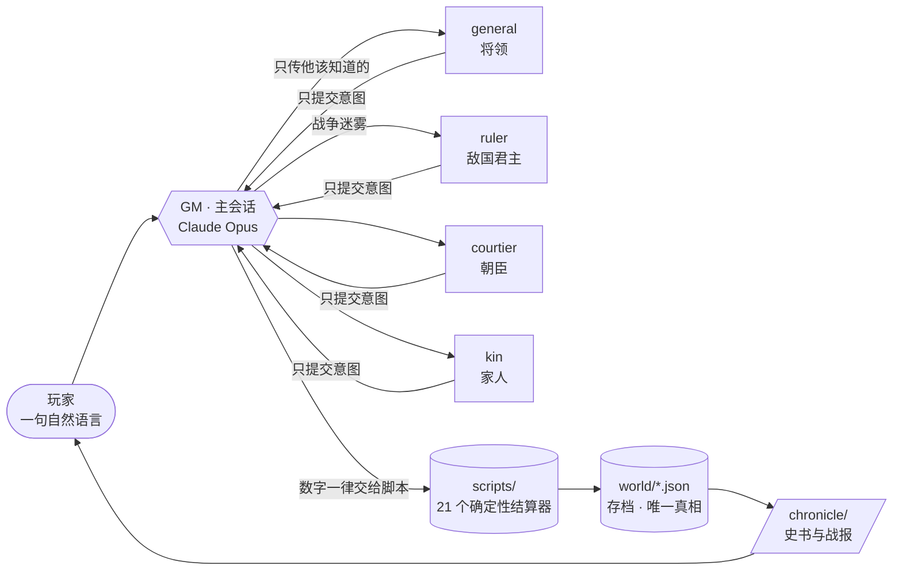

<div align="center">

# 山 河 一 局

**一个跑在 Claude Code 里的文字历史策略引擎**

*一灯，一案，一季。*
*Claude 坐在 GM 的位子上，替你点燃一个时代。*

```
> 依此施行
  ▸ 整理命令 …… 3 条军令 · 1 道奏疏 · 2 件家事
  ▸ 派发将领 …… general × 2   ruler × 1   courtier × 1
  ▸ 结算战事 …… resolve_battle.py  seed=0x3f2a
  ▸ 推进人心 …… loyalty.py   薛崇：安分 → 不满
  ▸ 书写史册 …… chronicle/turn_007.md
  ─────────────────────────────────────────────
  天复三年 秋 · 灵州 · 府库 钱 18,420 贯 · 粮 51,300 石
```

</div>

---

## 序

黄河从灵州城西流过，麦苗刚出土。帅府的案上摆着三封信：一封是党项的，一封是长安的，一封是家里母亲托人捎来的。

你说一句话，城外的马军就动了。将领领了命，各有各的算盘；敌国的君主在他的帐里读着斥候送来的残缺情报；后宅里，妻子在等你回去吃饭。

这里没有地图格子和血条。纸上写着的，是一个一个的人。

---

## 它是怎么运转的



**三层分工**

| 层 | 谁 | 做什么 |
|---|---|---|
| 叙事 | GM（Claude Opus） | 解读命令，扮演龙套，写战报、史书、见闻 |
| 人格 | 角色 agent（haiku） | 每个有名有姓的人一张人格卡，按性格自主行事，可能变通、拖延、抗命 |
| 数字 | Python 脚本 | 战斗、经济、人心、流言、秘密，全部由脚本掷骰结算；同一 seed 结果可复现 |

LLM 负责写人，脚本负责算账，存档是唯一的真相。故事写得再动人，也不能和账本对不上。

---

## 引擎里有什么

```
◆ 战  阵   resolve_battle.py · tactical.py     兵种、地形、阵形、士气；亲临阵前可按刻指挥
◆ 人  心   loyalty.py                          需求、心结、外部开价；安分 → 不满 → 怨言 → 留后路 → 暗通 → 举事
◆ 家  宅   household.py                        生老病死、议亲、立嗣；亲近 → 疏淡 → 怨怼 → 另有打算
◆ 朝  堂   court.py                            派系、奏疏、朝议、党争、仕途
◆ 关系网   relations.py                        师生、同年、姻亲、政敌，一笔一笔的恩怨
◆ 流  言   rumors.py                           在圈子之间传开、变形、消退，改写名望
◆ 秘  密   secrets.py                          谁知道什么、知道多少、证据在谁手里
◆ 场  景   scene.py                            巡一夜街、赴一场约，按更鼓和时辰推进
◆ 较  量   contest.py                          单挑、比射、辩论，伤势逐季恢复
◆ 识  人   persona.py                          十一项属性，你只看得到印象，看不到数字
◆ 治  理   governance.py · economy.py          亲领与委任，季节、赋税、粮饷
◆ 见  闻   vignette.py                         市井小景、家书、支线
```

纯 Python 标准库，约一万六千行，不需要安装任何依赖。

---

## 两卷剧本

### 卷一 · 朔方风云
> **唐天复二年（902）春，灵州。**
> 你是朔方节度使，手里有一万多兵、两座城。东边的党项定难军盯着盐池，南边关中大乱，朝廷顾不上西北。

### 卷二 · 长安夜
> **承平二十七年（956）春，长安。《朔方》三十年后。**
> 押盐纲进城的那一夜出了事，你留在金吾卫，做了一名巡夜的骑卒。天子射柳只射了一箭，储位没人公开说。

想换个时代？说一句 `/scenario`，再说一个时代、一个地点、一个身份，GM 会为你起草一卷新的剧本。

---

## 开始

```bash
git clone git@github.com:saarufer/SFgame.git
cd SFgame
claude
```

然后在 Claude Code 里：

| 命令 | 作用 |
|---|---|
| `/newgame` | 选剧本，回答几个关于主角和家人的问题，开局 |
| `/turn` 或说“依此施行” | 结束本季，按回合流程结算 |
| `/scenario` | 起草一个新剧本包 |
| “继续游戏” | 从存档接着玩 |

需要：[Claude Code](https://claude.com/claude-code)、Python 3。

---

## 目录

```
CLAUDE.md          GM 守则：铁律、回合流程、文风
.claude/agents/    general · ruler · courtier · kin · novelist · rules-engineer
.claude/commands/  newgame · turn · scenario
rules/             规则文本
scripts/           结算脚本
scenarios/         剧本包（开局存档、人格卡、剧本规则）
characters/        人格卡模板
```

对局中生成的 `world/`、`chronicle/`、`saves/` 不进仓库，每个人的山河各自保存。

---

<div align="center">

*史实只是背景，你走出来的那条路才是这一局的历史。*

</div>
